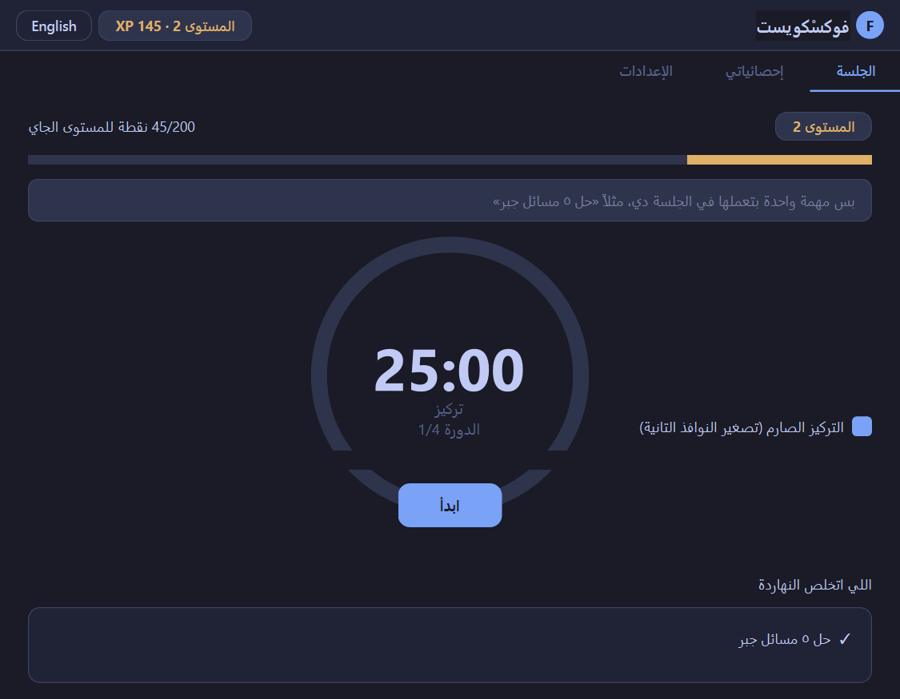
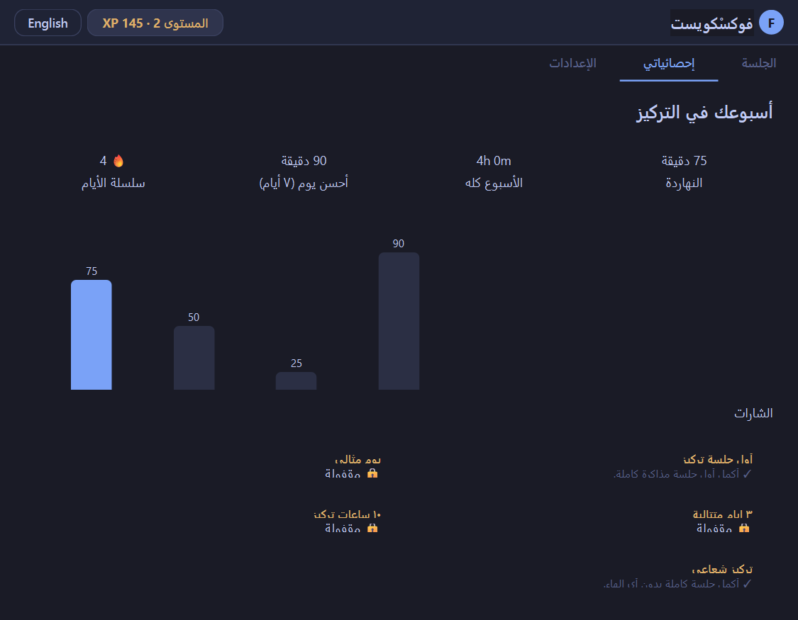
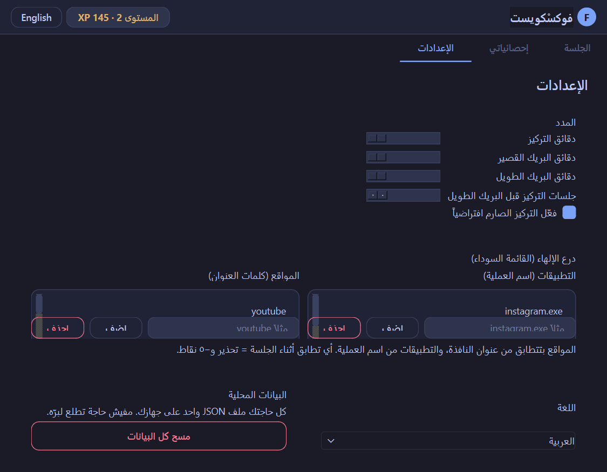

<div align="center">

# FocusQuest

**Gamified focus timer with a light distraction shield**

A Windows desktop app that turns Pomodoro sessions into an XP-levelling RPG — with soft warnings and small stakes, not hard blocks.








</div>

## Features

- **Pomodoro loop** — focus session, break, long break after N sessions, pause/resume, circular progress ring, sound + system tray notifications.
- **RPG layer (XP / Levels / Badges)** — earn XP for every focused minute, level up with celebration, unlock badges, lose a little when you quit early or get distracted.
- **Strict focus mode** — minimizes all other windows at session start; one-click restore afterwards.
- **Distraction shield** — watches the foreground app during a session. Opening a blacklisted app or a matching window title pops an always-on-top warning overlay and costs 5 XP.
- **One task per session** — a single-line backlog ("Solve 5 algebra problems"), checked off when the timer finishes. No to-do-list bloat.
- **Local stats** — daily focus minutes are stored locally in JSON. A weekly bar chart + headline numbers + badge gallery.
- **Bilingual UI** — Arabic (RTL) ↔ English (LTR), switchable instantly from the header or settings. Everything stays local; no accounts, no network.

## XP rules

| Event | XP |
|---|---|
| Focused minute | +1 |
| Completed session | +5 bonus |
| Quit a session early | −10 (floor 0) |
| Open a blacklisted app/site in-session | −5 per incident (10 s cooldown) |
| Level up from level *n* | `100 × n` XP |

Badges: **first session**, **perfect day** (4 sessions in a day), **3-day streak**,
**10 focused hours**, **laser focus** (a full session with zero distractions).

## Getting started

```bash
git clone https://github.com/msbalmoghazy333-bit/focusquest.git
cd focusquest
python -m venv .venv
.venv\Scripts\activate        # Windows
pip install -r requirements.txt
python run.py
```

> The distraction watcher and strict focus need Windows (`pywin32` is Windows-only).
> On other platforms they degrade gracefully: session timer, XP and stats still work,
> the shield simply reports itself unavailable.

Data lives in `%APPDATA%\FocusQuest\data.json` (atomic writes + `.bak` backup + self-healing on corruption).
Sounds are synthesized WAVs in `assets/sounds/` (see `tools/` for the generator).

## Architecture

```
focusquest/
├── core/          # Pure Python (no Qt) — unit-tested
│   ├── timer.py           # Deadline-based Pomodoro state machine (no drift)
│   ├── xp.py              # Level curve, penalties, badge rules
│   ├── storage.py         # Atomic JSON store + DataStore with listeners
│   ├── stats.py           # Session → day aggregation, streaks, headlines
│   └── models.py
├── services/      # System touch-points (Win32 / Qt services)
│   ├── blocker.py         # Foreground watcher (1 s poll, 10 s cooldown)
│   ├── focus_mode.py      # Minimize-others / restore
│   └── notifier.py        # QSoundEffect → winsound → bell fallback chain
├── i18n/          # ar/en dictionaries + RTL switch
└── ui/            # PySide6 views (thin — all logic lives in core/services)
    ├── main_window.py     # Orchestration, tray, overlays, dialogs
    ├── session_view.py    # Ring timer + task input + XP bar
    ├── stats_view.py      # Hand-drawn weekly chart (QPainter) + badges
    ├── settings_view.py   # Durations, blacklist editors, language, reset
    ├── overlay.py         # Always-on-top warning card
    └── theme.py           # Tokyo Night dark theme (single palette source)
```

Key design decisions:

- **No timer drift** — the clock is deadline-based (`time.monotonic()`), never decremented per tick, so a missed UI frame can't skew the session.
- **Testable core** — `core/` never imports Qt; `pytest` covers timer transitions, XP math, badge rules, storage round-trips and streak aggregation (see `tests/`).
- **Shield, not a cage** — detection is advisory (warning + small XP cost). No admin rights, no hosts-file edits, no browser extension needed — window titles are enough to catch YouTube & friends.
- **Safe storage** — writes go through a temp file + `os.replace`, previous good file kept as `.bak`, and a corrupt file self-heals from backup.

## Running tests

```bash
python -m pytest tests/ -q
```

## Roadmap (post-MVP ideas)

- Export/import data (CSV/JSON), weekly review nudge
- Custom badge definitions, configurable XP curve
- macOS/Linux ports isolating the OS layer in `services/`
- PyInstaller single-file build

## License

MIT — see [LICENSE](LICENSE).
